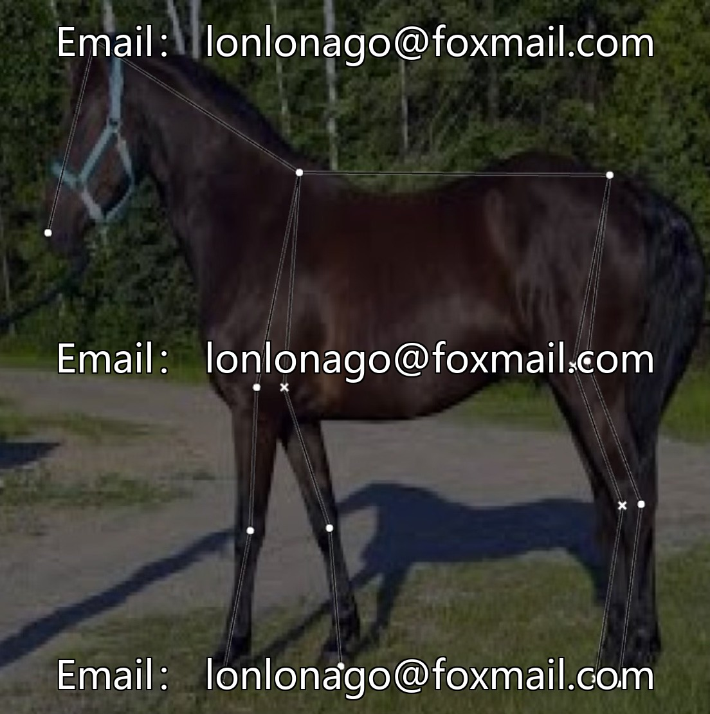
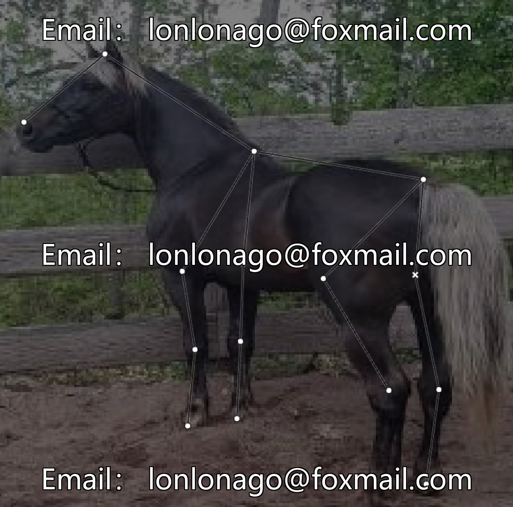

# Intelligent farming - Horse Key Points Detection Modeling Data Set, Issue 10464, 500

## Body

Intelligent farming - Horse key point detection modeling dataset, issue 10464, 500 labeled samples, YOLO format, suitable for horse key point detection model training and optimization, supports animal behavior analysis, intelligent monitoring of livestock scenes, etc.

Data focuses on a single core category "horse", with precise category division, no redundant classifications, diverse sample coverage, suitable for algorithm iteration in small sample scenarios. Can directly adapt to visual tasks related to horses, enhancing model training specificity.

Virtual materials, once sold, are non-refundable.
Interested friends, click "I want" to proceed.

## Images

## Payment

Here is a pay link on Stripe ( https://buy.stripe.com/3cs8yP7sY87d0vu9AB ). Please contact me lonlonago@foxmail.com after funding $89, and I will send you a complete data files , thank you!

